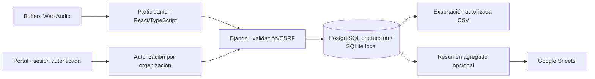

# Arquitectura

## Organización del código

- `src/app.tsx`, `src/types.ts`: interfaz React, estado y tipos del cuestionario.
- `public/audio.js`: motor de audio independiente; un contexto/reloj, tres buffers predecodificados y ganancias.
- `public/model.js`: reglas puras de ranking, aleatorización y seguridad CSV.
- `public/questions.json`: protocolo de demostración estático y semilla inicial.
- `core/models.py`: entidades relacionales; `core/services.py`: validación y transacciones.
- `core/views.py`: endpoints y portal con alcance por organización.
- `core/forms.py`: creación declarativa de preguntas.
- `core/management/commands/`: semilla, retención y espejo agregado de Sheets.
- `templates/portal/`: portal Django, sin SPA adicional innecesaria.
- `config/`: despliegue, middleware y rutas.
- `tests/`, `core/tests.py`: reglas, persistencia, autorización y navegador.
- `data/`: SQLite y audio privado, fuera de Git.

## Persistencia

Borrador local en navegador con caducidad lógica de 90 días al abrir. En Django, envío explícito mediante POST transaccional. IDs de sesión estables y reintentos idempotentes evitan duplicados. Una clave aleatoria de retirada se conserva en el navegador y en el JSON del participante; la BD sólo guarda su hash. No exponer esa clave en CSV de investigadores.

Los protocolos publicados son inmutables por la API/portal; clonar crea versión nueva. Las respuestas apuntan a preguntas y protocolo exactos. Sólo hay datos demo. Los tiempos de cliente son observacionales y se validan en rango; `received_at` lo fija el servidor.

## Escalado

Backend inicialmente monolítico. Producción: procesos ASGI/WSGI detrás de proxy HTTPS, PostgreSQL administrado en región aprobada, Redis compartido para límites, almacenamiento de objetos para estímulos. CDN para archivos públicos/licenciados; acceso firmado para material restringido. No transferir audio desde Django en producción.

Agregar trabajadores de tareas cuando existan procesados/mediciones/exportaciones pesadas; no bloquear peticiones con FFmpeg. Particionar sólo cuando el volumen real lo justifique. Medir latencias, número de consultas y tamaño de respuestas antes de optimizar. El export CSV de la PoC se construye en memoria: sustituir por exportación asíncrona/paginada para datasets grandes.

El portal es HTML server-rendered de Django; la experiencia auditiva sí es React/TypeScript. Un editor visual complejo podrá usar componentes React sobre la misma API; no exige reescribir permisos ni datos.

## Dos modos de entrega

1. Django local: portal, SQLite, audios proporcionados y envío persistente real de **datos de prueba**.
2. Sites privado: bundle estático, audio sintético y almacenamiento local. No contiene backend, miembros, cuentas ni la BD. Debe indicarse en la UI.

Una demo estática no prueba la arquitectura de hosting multiusuario. Para producción faltan proveedor, configuración PostgreSQL/Redis, pruebas con PostgreSQL, backups/restauración y revisión institucional. `APP_ENV=production` falla al arrancar si faltan secretos o bases esenciales; SQLite está prohibido en ese modo.

Audio importado: se conserva mediante IndexedDB en el dispositivo para reanudar la demo. No se sube al backend; la retirada local elimina también esa copia. La caducidad del borrador se comprueba al volver a abrir la aplicación, no mediante un proceso que se ejecute con el navegador cerrado.
